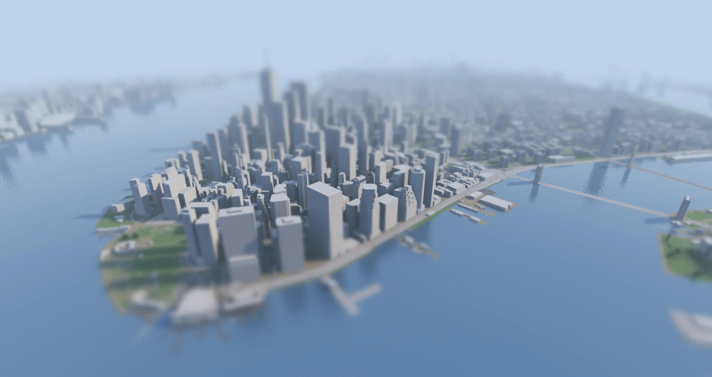
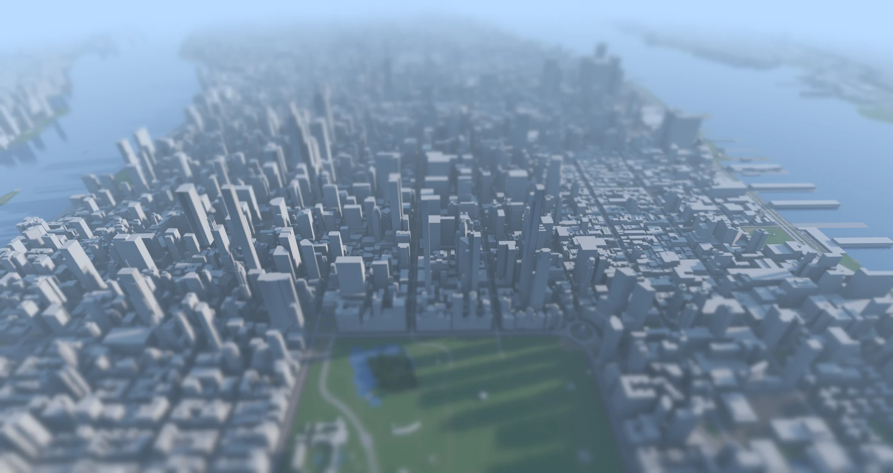
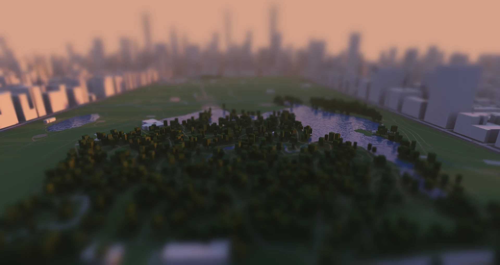
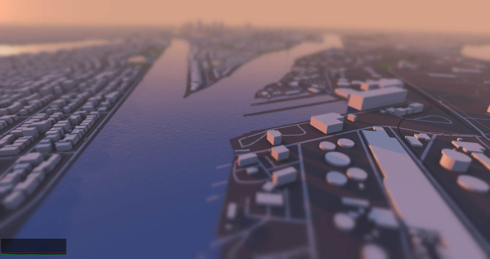

raytraced map
=============

**[Live demo](https://johanholwerda.github.io/raytracedMap/)** (needs WebGPU)

A WebGPU renderer for OpenStreetMap cities, anywhere in the world. Sky light and sun shadows are ray traced against the extruded building footprints and cached in a virtual lightmap: a sparse, view dependent lightmap whose tiles live in a hash table. It is the scheme of [virtualLightmaps](https://github.com/johanholwerda/virtualLightmaps) with the albedo at 0: a texel holds the part of the sky its point sees and the part of the sun disc it sees, nothing else.

The geometry is streamed as vector tiles while the camera moves, so nothing is baked. A view converges in a few hundred frames at most, after which nothing is traced or drawn until the camera, the sun or the geometry changes.

The frame
---------

1. gBuffer, 1 pass with a jittered camera: the lightmap surface id, the normal (octahedral, 2 x 10 bits), a material index, and on walls the position in the wall atlas. 12 bytes per pixel plus the depth.
2. The lightmap update, 3 compute passes: claim, select, trace. See below.
3. Optional: the lightmap lookup at half resolution, and the water reflection rays at half or quarter resolution.
4. Deferred shading: `albedo * (sunColor * n.l * sunVisibility + skyColor * skyVisibility)`, water reflections, tone map, fog. A reflection ray traced through the city gives its nearest hit; where the screen shows that point, the water mirrors its color from the TAA history of the frame before.
5. TAA, tilt shift blur, cars.

Charts
------

A lightmap needs a 2D parametrization of the surfaces. It is made per map tile in the worker that builds the geometry (`cityLayout.ts`), and a point on it is a 32 bit surface id plus a 2D position in world units:

- The ground is 1 chart for the whole map: world xz.
- The roofs are world xz too, but not in the chart of the ground: 1 chart per roof height, in steps of 25 cm. The chart id is part of the tile hash, so a roof and the ground under it get different tiles and never share a texel. Roofs of the same height that touch do share theirs. (In 1 chart with the ground, a texel on the outline of a roof would average the open roof and the occluded ground at the foot of its walls.)
- The walls of a map tile are unrolled into strips, 1 per footprint ring: u along the ring, v the height above the base. The strips are cut at corners into chunks of at most 64 m and packed in rows into an atlas per map tile, in Morton order of their buildings, so a coarse texel that spans 2 chunks mixes walls that are near each other in the world.

Ground and roof pixels get their chart position from the depth. Wall pixels read it from the gBuffer, 19 bits per axis in steps of 1 cm. The atlas is as large as it needs to be: only the parts that pixels use take room in the lightmap.

The virtual lightmap
--------------------

- **Levels.** Texels are `texelSizeMin * 2^level` in size (20 cm at level 0). The level of a pixel follows from its distance, so there are `texelsPerPixel` texels per pixel (.15 to 1 by quality). A grazing view angle adds up to 2 levels, and where the tilt shift blur is wider than a texel the level follows the blur instead.
- **Tiles.** A level of a chart is divided in tiles of 8 x 8 texels. A tile is identified by a 32 bit hash of (surface id, level, tile xy), and stored in an open addressing hash table with linear probing over `searchCount` slots (8 or 16). The slot index is also the place of the tile's 64 texels in the lighting buffer, so there is no indirection table. Only the hash is stored, not the key.
- **Eviction.** A tile is stamped with the frame it was last used in. When the probe sequence of a new tile has no empty slot, it takes the place of the tile that is unused the longest, if that is more than `evictFrames` (30, down to 2 while the camera travels). When nothing can be evicted, the cell uses the texel of a coarser level.
- **Texels.** 1 `u32` per texel, holding ray counts: sky rays that reached the sky (9 bits), sky rays (9 bits), sun rays that reached the sun (7 bits), sun rays (7 bits). The visibility is hits / rays. The cap is 508 sky paths and 127 sun rays per texel. All writes are a compare exchange on that 1 word, so the sky and the sun of a batch go in together and a field can not overflow into the next.

A lightmap of 4096 x 4096 texels (high quality) is 262144 tiles. Its lighting buffer is 64 MB, at 4 bytes per texel. The update needs a second buffer of the same size: 1 word per texel for the bids of the cells (see claim below), which also records the frame the texel was last sampled in. So 128 MB in all.

The update
----------

The screen is divided in cells of 1.5 to 4 pixels along a side (at 1080p, scaled with the pixel count). Each frame:

1. **claim.** Every cell picks a random pixel in it, reads the gBuffer and finds its texel, inserting the tiles of its level and of 2 coarser levels. If the texel still takes samples, the cell bids on it: a word per texel with the frame in the high bits and a random number below it, where a compare exchange keeps the highest. Many cells show the same texel, 1 of them wins.
2. **select.** The winners are compacted into a list, which becomes the indirect dispatch of the trace. The rays per frame are capped (`traceSamplesMax`, 256k to 4096k by quality): above the cap a random part of the winners is left out.
3. **trace.** Only the winners trace, `sampleCount` rays each (8 to 32), spread over up to 8 threads per cell. The first thread sums the results and adds them to the texel and to the 2 coarser texels above it, coarse to fine. A texel without rays starts from the coarser one as at most `seedCount` (32) rays.

So the ray count follows the number of texels in view that have not converged, not the number of pixels. When few cells still win a bid, each of them traces more rays (up to 128) to finish the texels that cells rarely pick.

Sky samples
-----------

A sky sample is 1 any hit ray: it reaches the sky or it does not. There are no bounces, so no hit point, normal or material is needed.

- The direction is cosine weighted around the normal. The random numbers are a 2 channel blue noise texture, read at the place of the texel in the lightmap and moved along the R2 sequence by the number of paths the texel has taken so far. A texel walks 1 low discrepancy sequence without gaps over the frames, whichever cells sample it.
- The texel average is then the cosine weighted sky visibility: 1 on an open roof, .5 on an open wall. The shading multiplies it by the sky color.
- The ground is not in the BVH. A ray that goes down ends on the ground or on a building, which both add nothing, so it is a miss without a trace. On a wall, half of the lobe goes down. There only the upper half of the lobe is sampled and each ray counts as 2 paths: itself and its mirror image down, which is 0. Twice the information per traced ray.
- The ray starts 2 cm off the surface.

The sky visibility does not depend on the light. A change of the time of day changes the sky color in the shading and leaves the sky half of the texels as it is.

Sun samples
-----------

The sun visibility is in the same texels, traced by the same cells in the same pass, and replaces a shadow map.

- Of the `sampleCount` rays of a cell, 1 in 8 goes to the sun while both channels take samples. All of them (16 at most) go to the sun when only the sun is left, which is the case after the sun moved. None when the sun field is full.
- A sun ray goes to a uniformly distributed point on the disc of the sun (angular radius .01 rad by default). The points come from the same blue noise in another R2 dimension, indexed by the sun rays the texel took so far.
- The ray starts off the surface by 1e-4 times the camera distance. A ray into the surface (a face away from the sun, or the part of the disc below its horizon) is a miss without a trace.
- Sun and sky rays go through 1 call of the traversal, so the threads of a subgroup stay in the same loop.

Most texels are fully lit or fully in shadow, and the sun field has room for only 127 rays. So the count is adaptive:

- While all sun rays of a texel agree, a ray counts as several: the sun count goes up in step with the sky count and the texel is done with a quarter to an eighth of the rays.
- The first ray that disagrees marks the texel as in a penumbra. Its count is scaled back to the rays that were actually traced, and from then on a ray counts once, up to 127 traced rays. The cell also splits its rays between the sun and the sky by the room each has left, so both fill up together.

At a sunset the penumbras are wide (20 m per 100 m of shadow) and cover many texels. Measured on New York at sunset, 1080p, high quality, the noise on the shadow edges went from .057 (1 sun ray per 16 paths, numbered by the frame) to .018, for 241 instead of 223 frames to converge. Counting every sun ray once in every texel gives .0175 but takes 316 frames.

When the sun moves, 1 compute pass clears the sun fields of all texels and keeps the sky fields. The shading looks up the sun only on faces that face it.

What the rays hit
-----------------

Not triangles. A building is its footprint polygon extruded from a base to a flat roof, and is intersected as such (`skyVisibilityTrace.wgsl`): the ray is tested against every edge of the footprint in 2D with a height test, and where it crosses the plane of the roof or the floor an even-odd test says whether it is inside the footprint. A building record is 1 vec4 plus 1 vec4 per edge. A tree is 2 boxes, a trunk and a crown.

Each map tile has a BVH over its buildings and trees, built in the worker. A top level BVH over the tiles (1024 at most) is rebuilt when a tile comes or goes. All nodes are in world space in 1 storage buffer of 128 MB, so the 2 levels are traversed as 1 tree in 1 loop, with a stack of 16 (8 on mobile). Any hit ends the ray, the near child is visited first.

The same buffer is traced for the water reflections, the per pixel shadow mode and the lighting of the cars.

Streaming
---------

Tiles come and go while the lightmap holds samples of the buildings of before. Every tile that comes or goes leaves a box with a frame number (16 at most, merged when there are more). The frame part of a texel's claim is when it was last sampled. In the claim pass, a texel that was last sampled before a change gets stale:

- its sky visibility, when it is within 2 times the height of the tallest building around the box,
- its sun visibility, when a ray from it to the sun passes through the box, at any distance. At a sunset the shadows are 10 times as long as the buildings are high.

A stale texel keeps its value to show, with a count of next to nothing: the cell bids on it again and the first new rays replace it. The 8 texels around it are tested too, since the bilinear lookup reads texels that no pixel shows, such as the ones under a building that just arrived.

The lookup
----------

Per pixel, from its surface point and its fractional level (`skyVisibilityResolve.wgsl`):

- The 4 texels around the point at a level are blended bilinearly, weighted by their ray counts. Each needs a hash table lookup when they are in different tiles. Both channels come from the same lookups.
- 2 levels are blended, in the middle half of a level only. With the TAA on, a pixel reads 1 of the 2 levels, picked by noise per pixel and frame.
- A level with few rays leans on the coarser level above it, which gets the rays of 4 times as many cells. The weight of the coarser level fades out at 254 rays.
- No texel at any level: the visibility of an open sky, `n.y * .5 + .5`, and lit by the sun.

The lookup is the most expensive part of the shading. On medium quality it is done for 1 pixel per 2 x 2, into a target that also holds a key of the surface point (a hash of the surface id, the level, and the position at that level). A full resolution pixel blends the samples around it whose key matches its own surface point. On low it samples them bilinearly without the test.

Convergence
-----------

The select pass counts the winning cells whose texel has less than 256 rays, and the count is read back. Below .5% of the cells the lightmap counts as converged. When the TAA has converged as well (32 static frames) and the water is not animated, the map is not drawn again and the last image is presented.

Quality
-------

| | lightmap | texels per pixel | rays per frame, max | rays per cell | cell | lookup |
|---|---|---|---|---|---|---|
| very high | 6144 | 1 | 4096k | 32 | 1.5 px | per pixel |
| high | 4096 | .6 | 1536k | 16 | 2 px | per pixel |
| medium | 3072 | .3 | 256k | 8 | 4 px | half res |
| low | 2048 | .15 | 256k | 8 | 4 px | half res, bilinear |

High is the default on desktop, medium on mobile. Low uses cascaded variance shadow maps for the sun instead of the lightmap. Very low and forward have no lightmap.

The `drawMode` param has debug views of the lightmap: the sky light alone, the lightmap itself, its tiles, its levels, the texels that still converge, the shadows alone and the wall atlas. `rayGraph` in the virtual lightmap group draws the rays per frame, as in the last screenshot.

Data
----

Ground layers and building footprints with heights are OpenFreeMap vector tiles (OpenMapTiles schema, zoom 14), 1 request per tile, fetched, decoded and triangulated in workers. Addresses of clicked buildings are from Nominatim. © OpenFreeMap © OpenMapTiles, data © OpenStreetMap contributors.

The height of the ground is from the terrarium elevation tiles of the AWS terrain tiles (Mapzen), at zoom 12, fetched and decoded in the worker that also fetches the map tiles (`ElevationService.ts` in `tileFetchWorker.ts`), which hands each tile with its heights to a build worker. Each map tile gets a grid of 65 x 65 heights, 1 cell per pixel of the elevation tiles, relative to the ground at the projection center, and the worker builds on it (`terrainGrid.ts`):

- the ground: a mesh of the grid, 2 triangles per cell, instead of the flat ground quad.
- the normals: smooth, at the grid points from the heights around them (the grid has a ring of the neighbour tiles' heights, so both sides of a tile edge get the same ones), interpolated inside a triangle of the ground. A ground or layer vertex has its normal in the free .w of its vec4, x and z in 11 bits each, as an integer a float holds exactly (`terrainNormal.wgsl`). The water keeps the normal up, the buildings the flat one of the fragment shader.
- the ground layers: cut along the grid lines and the cell diagonals where the ground under them isn't planar, so every piece lies on 1 triangle of the ground, and lifted to it. 1.7 to 4 MB per tile in San Francisco and Amsterdam, 5 to 10 times the flat layers (the log has it per tile and in all).
- the buildings: from the lowest ground under the footprint. A part over the ground (a tower on a podium) from the ground of the part around its center. Trees from the ground at their center.

The main thread keeps the same grids (`TerrainHeightField.ts`) for what moves over the ground: the cars stand on it, sheared along the slope under them, the orbit pivot eases to the ground under it, and the plane flies at its height over the ground, its pivot where the view ray meets the terrain.

The ray tracing still has no ground: a ray that goes down misses, as before, and hills don't shade. Outside the US most sources are surface models, with the buildings in them: Amsterdam's center is a mound of some 12 m. The `elevation` toggle in the layers turns it off. Terrain Tiles © Mapzen.

Running
-------

    npm i
    npm run dev

`npm run build` builds to `dist`, `npm run preview` serves it, `npm run typecheck` runs the type check.
